<!-- Header: auto-scrolling Behance projects -->

  

  
  

---

### About me

I make things people remember. Curious, playful, always experimenting. Let’s create something fun.

- Designing websites, brands and visuals that feel alive
- Always playing with new tools, styles and ideas
- Open to fun collaborations, come say hi!

### Tools I play with

  

### See my work

### Selected work

  

