<!-- Header: auto-scrolling Behance projects -->

  

  
  

---

### About me

I make things people remember. Curious, playful, always experimenting. Let’s create something fun.

- **Brands across food, coffee, sport and tech**, from pizza and coffee to sports academies and AI products
- **Design to code**: took a travel app from branding to UI to development
- **3D and AI visuals**: created a cast of AI characters and immersive 3D product worlds
- **Open to freelance and collaborations**, let’s make something people remember

### What I do

  

### Tools I play with

  

