<!-- Header -->

  

  
  

  

---

### 🌸 About me

I make things people remember. Curious, playful, always experimenting. Let’s create something fun.

- 🎨 Designing websites, brands and visuals that feel alive
- 🧪 Always playing with new tools, styles and ideas
- 🤝 Open to fun collaborations — come say hi!

### 🛠️ Tools I play with

  

### 🖼️ See my work

